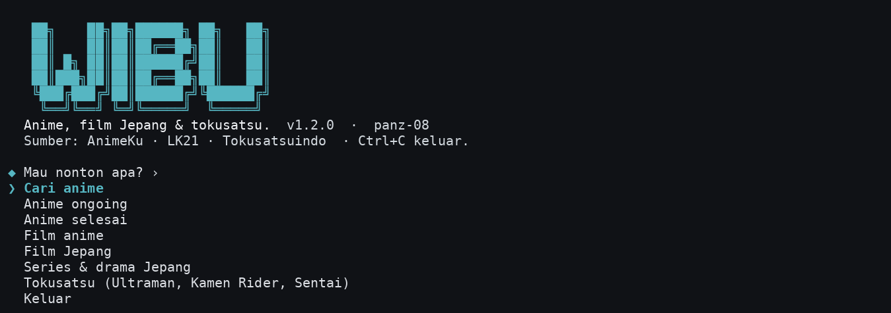
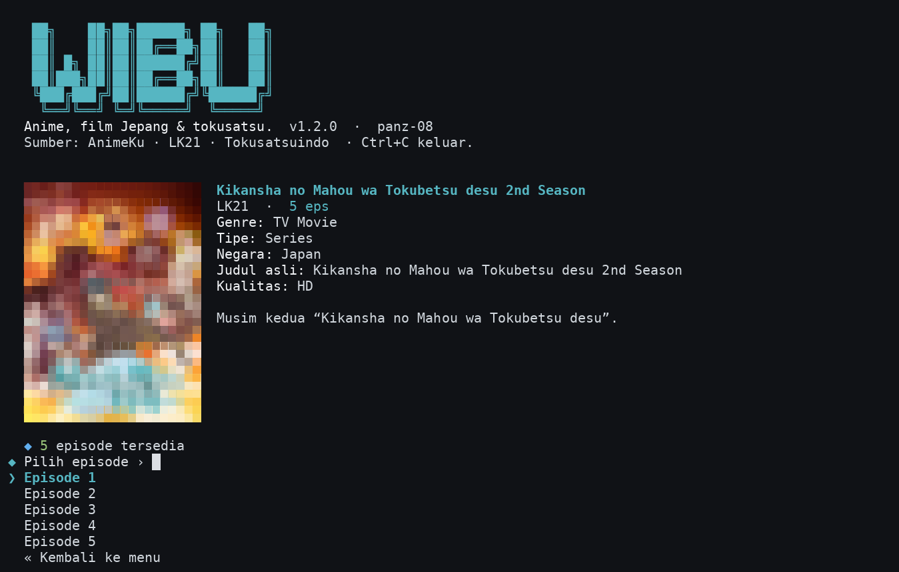
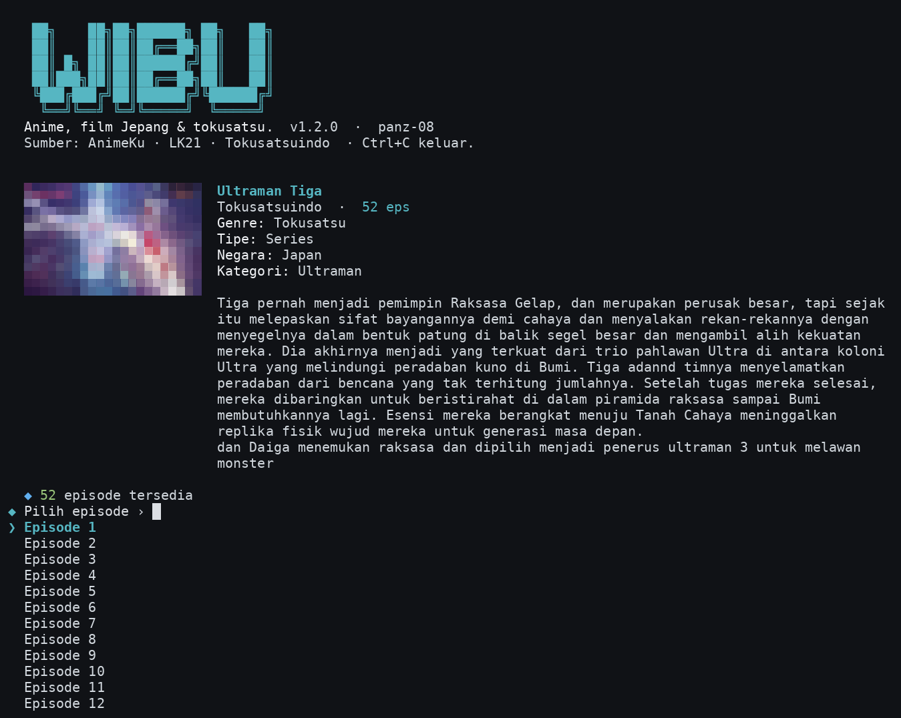
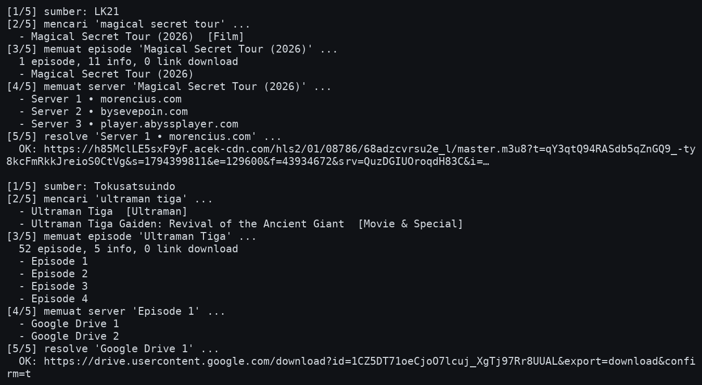

# wibu-cli

[](https://github.com/Panz-08/wibu-cli/actions/workflows/ci.yml)
[](https://github.com/Panz-08/wibu-cli/releases)
[](LICENSE)

Nonton anime, film Jepang, series/drama Jepang, dan tokusatsu dari terminal.
Video diputar langsung di MPV tanpa perlu buka browser.

Sumber yang dipakai:

- **AnimeKu** untuk anime, dengan **Otakudesu** sebagai cadangan otomatis.
- **LK21** untuk film Jepang dan series/drama Jepang.
- **Tokusatsuindo** untuk Ultraman, Kamen Rider, Super Sentai, dan movie/special.

Proyek ini lanjutan dari [animeku-cli](https://github.com/zevtyardt/animeku-cli)
yang sumbernya sudah tidak jalan. Saya pakai sendiri hampir tiap hari, jadi
sekalian saya rapikan dan taruh di sini. Kalau ada yang ikut pakai, silakan.

## Fitur

- Cari anime atau jelajahi kategori ongoing, selesai, dan film.
- Cari film Jepang dan series/drama Jepang, atau jelajahi katalognya.
- Cari Ultraman, Kamen Rider, Super Sentai, dan movie/special.
- Pilih episode lewat daftar. Anime diurutkan dari episode terbaru; series
  Jepang dan tokusatsu diurutkan dari episode 1.
- Resolve player langsung ke HLS, MP4, atau Google Drive, lalu buka MPV.
- Fallback otomatis ke Otakudesu kalau AnimeKu sedang bermasalah.
- Poster dan info judul tampil di terminal. Posternya disembunyikan kalau
  terminal terlalu sempit.
- Navigasi halaman untuk katalog anime dan film/series Jepang.
- Link download ditampilkan kalau sumbernya menyediakan.

## Tampilan

Gambar-gambar ini diambil dari aplikasi yang benar-benar dijalankan lewat PTY,
bukan mockup.

Menu utama:



Series Jepang dari LK21, lengkap dengan poster dan daftar episode:



Ultraman Tiga dari Tokusatsuindo:



Contoh `--probe` untuk film LK21 (HLS) dan Ultraman Tiga (Google Drive):



## Instalasi

Butuh Rust dan `mpv` di `PATH`.

### Langsung dari GitHub

```bash
cargo install --git https://github.com/Panz-08/wibu-cli --locked
```

Pastikan `~/.cargo/bin` ada di `PATH`. Setelah itu jalankan:

```bash
wibu-cli
```

### Binary siap pakai

Kalau tidak mau install Rust, ambil binary Linux x86_64 dari halaman
[Releases](https://github.com/Panz-08/wibu-cli/releases). Ekstrak, taruh
`wibu-cli` di `PATH`, lalu jalankan.

Untuk macOS dan Windows belum ada binary resmi. Build dari source di bawah.

### Dari source

```bash
git clone https://github.com/Panz-08/wibu-cli.git
cd wibu-cli
cargo install --path . --locked
```

Untuk coba tanpa install:

```bash
cargo run --release
```

### Install mpv

- Arch / Manjaro: `sudo pacman -S mpv`
- Debian / Ubuntu: `sudo apt install mpv`
- Fedora: `sudo dnf install mpv`
- macOS: `brew install mpv`
- Windows: unduh dari <https://mpv.io/installation/>, lalu tambahkan folder
  `mpv.exe` ke `PATH`.

## Pemakaian

```bash
wibu-cli                     # mode interaktif
wibu-cli --help
wibu-cli --version
```

Di menu interaktif ada tiga entri baru:

- **Film Jepang** untuk film Jepang umum.
- **Series & drama Jepang** untuk series/drama Jepang.
- **Tokusatsu (Ultraman, Kamen Rider, Sentai)** untuk judul tokusatsu.

Beberapa opsi yang berguna:

```bash
wibu-cli --source animeku    # paksa AnimeKu (default)
wibu-cli --source otakudesu  # paksa Otakudesu
wibu-cli --source jepang     # paksa LK21 untuk film/series Jepang
wibu-cli --source tokusatsu  # paksa Tokusatsuindo
wibu-cli --probe frieren 0   # tes cari + episode + resolve
wibu-cli --resolve 'https://morencius.com/embed/68adzcvrsu2e'
```

Contoh uji sumber Jepang:

```bash
wibu-cli --source jepang --probe "magical secret tour" 0
wibu-cli --source jepang --probe "Kikansha no Mahou wa Tokubetsu desu" 0
wibu-cli --source tokusatsu --probe "ultraman tiga" 0
```

`--probe` dan `--resolve` dipakai buat ngecek apakah sumber dan resolver masih
jalan. Keduanya tidak butuh terminal interaktif.

### Contoh output `--probe`

Output asli dipotong, tapi urutannya seperti ini:

```text
$ wibu-cli --probe frieren 0
[1/5] sumber: AnimeKu
[2/5] mencari 'frieren' ...
  - Sousou no Frieren
[3/5] memuat episode 'Sousou no Frieren' ...
  28 episode, 8 info, 2 link download
  - Episode 28
  - Episode 27
[4/5] memuat server 'Episode 28' ...
  - Server 1
  - Server 2
[5/5] resolve 'Server 1' ...
  OK: https://contoh-host/api/hls?t=...
```

Kalau resolve gagal, baris terakhir berubah menjadi `GAGAL resolve` dan proses
keluar dengan status 1.

## AnimeKu vs Otakudesu

| | AnimeKu (utama) | Otakudesu (cadangan) |
| --- | --- | --- |
| Kapan dipakai | default, atau `--source animeku` | otomatis saat AnimeKu gagal, atau `--source otakudesu` |
| Katalog | ongoing, selesai, film, dan halaman berikutnya | pencarian dan daftar episode |
| Pagination | didukung | tidak, hanya hasil pencarian |
| Resolver | `putarin.biz` / `puterin.biz` lewat `window.__PX` | iframe player, resolve langsung |
| Poster | tampil kalau terminal ≥ 62 kolom | tampil kalau sumber menyediakan |
| Link download | kalau tersedia | kalau tersedia |

Fallback otomatis **hanya** terjadi kalau sumber tidak dipaksa. Kalau kamu
menjalankan `--source animeku`, kegagalan AnimeKu akan ditampilkan apa adanya
tanpa berpindah ke Otakudesu.

Contoh membandingkan kedua sumber:

```bash
wibu-cli --probe "sousou no frieren" --source animeku
wibu-cli --probe "sousou no frieren" --source otakudesu
wibu-cli --source otakudesu          # seluruh sesi memakai Otakudesu
```

## Variabel lingkungan

| Variabel | Fungsi |
| --- | --- |
| `WIBU_ANIMEKU_BASE` | Ganti domain AnimeKu. Default `https://animeku.lol`. |
| `WIBU_LK21_BASE` | Ganti domain LK21. Default `https://layarkaca21.health`. |
| `WIBU_TOKUSATSU_BASE` | Ganti domain Tokusatsuindo. Default `https://www.tokusatsuindo.com`. |
| `WIBU_NO_IMAGE=1` | Matikan poster di kartu metadata. |
| `WIBU_BROWSER=1` | Selalu buka browser, jangan pakai MPV. |
| `XDG_CACHE_HOME` | Lokasi cache poster. Default `~/.cache/wibu-cli/posters`. |

## Cara kerja

### AnimeKu dan Otakudesu

1. Daftar anime diambil dari HTML AnimeKu. Slug kategori dibaca dari navigasi
   homepage, jadi tidak di-hardcode dan tetap jalan kalau slug berubah.
2. Halaman episode menyediakan iframe player, biasanya dari `putarin.biz` atau
   `puterin.biz`.
3. Player di-resolve dengan membaca `window.__PX`, meminta key ke `/api/pk`,
   lalu mendekripsi payload AES-256-GCM untuk mendapat URL `/api/hls?t=...`.
4. URL HLS diputar dengan MPV.

Kalau AnimeKu gagal, pencarian dicoba lewat Otakudesu. Sumber yang sedang
dipakai terlihat di kartu metadata.

### Film dan series Jepang (LK21)

1. Katalog dibaca lewat REST WordPress:
   `/wp-json/wp/v2/posts` untuk film dan `/wp-json/wp/v2/tv` untuk series,
   dengan filter `muvicountry=1096` (Japan).
2. Pagination memakai header `X-WP-TotalPages`.
3. Halaman detail menyediakan fakta, sinopsis, poster, dan kartu episode.
4. Player dimuat lewat `admin-ajax.php` (`p1`, `p2`, `p3`), lalu iframe-nya
   di-resolve.
5. Player seperti `morencius.com` memakai packed JavaScript; URL HLS di-unpack
   lalu diputar. Player seperti `vkspeed.com` menghasilkan MP4 langsung.

### Tokusatsuindo

1. Katalog series dibangun dari empat halaman kategori: Ultraman, Kamen Rider,
   Super Sentai, dan Movie & Special. Pencarian dilakukan lokal dari katalog
   itu karena pencarian WordPress mengembalikan post episode, bukan series.
2. Halaman episode menyimpan iframe player dalam atribut `data-embed` berisi
   base64.
3. Chain player: `/x/` → ambil `data-src` → `/p/` → ID Google Drive.
4. ID Google Drive diubah menjadi tautan direct
   `drive.usercontent.google.com/download?...` supaya MPV tidak butuh browser.

### MPV

Sebagian host memakai segmen HLS tanpa ekstensi, jadi MPV diberi opsi:

```text
--demuxer-lavf-o=extension_picky=0,allowed_segment_extensions=ALL
```

Referer halaman episode dikirim ke player yang membutuhkannya. Untuk
`vkspeed.com` dan CDN `vkcdn5.com`, Referer justru tidak dikirim karena host
itu menolak Referer asing.

## Troubleshooting

**`MPV tidak ditemukan di PATH.`**

Install `mpv`, lalu cek dengan `mpv --version`. Kalau tetap tidak ketemu,
pastikan lokasi binary-nya ada di `PATH`. Di Windows, tambahkan folder tempat
`mpv.exe` berada ke `PATH` lalu buka terminal baru.

**`wibu-cli harus dijalankan langsung di terminal interaktif.`**

Mode interaktif butuh stdin dan stdout berupa TTY. Jalankan `wibu-cli` langsung
dari terminal, bukan lewat pipe, cron, atau `nohup`. Untuk pengecekan otomatis,
pakai `--probe` atau `--resolve` yang tidak butuh TTY.

**`AnimeKu: ...` lalu `Otakudesu: ...`**

Kedua sumber gagal dihubungi. Biasanya ini masalah jaringan atau domain sumber
berubah. Cek koneksi, lalu coba `WIBU_ANIMEKU_BASE=https://ww2.animeku.lol`.
Kalau hanya AnimeKu yang bermasalah, fallback Otakudesu akan dipakai otomatis
(tanpa `--source`).

**`Tidak ada server streaming untuk episode ini.`**

Episode ada, tetapi tidak ada iframe player yang bisa di-resolve. Coba episode
lain, atau jalankan `wibu-cli --probe <judul>` untuk melihat server apa yang
terdeteksi.

**`Server ini tidak mengembalikan tautan video.`**

Server mengembalikan halaman yang tidak berisi URL HLS. Coba server lain di
daftar, atau cek apakah resolver masih cocok dengan struktur halaman sumber.

**`MPV keluar dengan status N`**

Resolve berhasil tapi MPV menolak URL/stream. Coba buka URL hasil `--probe`
langsung dengan `mpv <url>` untuk melihat pesan lengkap. Kalau memakai
`WIBU_BROWSER=1`, video dibuka di browser, jadi masalah MPV tidak berlaku.

**LK21 atau Tokusatsuindo tidak bisa dibuka**

Domain sumber bisa berubah. Cek di browser, lalu set `WIBU_LK21_BASE` atau
`WIBU_TOKUSATSU_BASE` ke domain yang aktif. Kalau satu server episode gagal,
coba server lain atau episode lain.

**Episode LK21 tertentu gagal**

Sebagian episode memakai player `play.xtwap.top` yang dilindungi Cloudflare
dan bisa mengembalikan 403. Tab server `p2`/`p3` untuk episode itu biasanya
kosong. Kalau server pertama gagal, pilih server lain; kalau semuanya gagal,
coba episode lain.

**Poster tidak muncul atau terlihat aneh**

Poster hanya muncul di terminal minimal 62 kolom. Kalau tetap berantakan,
matikan dengan `WIBU_NO_IMAGE=1`. Font monospace yang mendukung blok Unicode
(`▀`) lebih aman.

**Video gagal diputar**

Jalankan `wibu-cli --probe <judul>` untuk melihat sampai mana prosesnya
berhasil. Kalau resolve dapat URL tapi MPV gagal, coba buka URL tersebut
dengan `mpv` langsung untuk melihat pesan errornya.

## Status proyek

Proyek ini masih tahap awal dan masih saya kembangkan sambil dipakai. Tapi
bukan cuma rancangan: binary-nya sudah jalan, instalasi dari GitHub sudah
dicoba, dan alur cari judul sampai putar di MPV sudah dites langsung.

Versi 1.2.0 menambahkan sumber Jepang. Pengujian live terakhir dilakukan pada
11 November 2026. Sumber film dan tokusatsu bisa mengubah struktur halaman,
mengganti domain, atau memasang proteksi tambahan kapan saja. Kalau itu
terjadi, parser dan resolver mungkin perlu disesuaikan.

## Pengujian

### Otomatis

```bash
cargo fmt --check
cargo check --locked
cargo test --locked
cargo build --release --locked
```

- 29 unit test lulus. Cakupannya: parser AnimeKu, Otakudesu, LK21,
  Tokusatsuindo, resolver embed (AES, packed JavaScript, HLS, Google Drive),
  dan pembersihan teks dari script iklan.
- CI GitHub Actions menjalankan format, check, test, dan build setiap push ke
  `main`.

### Manual

Pengujian live pada 11 November 2026:

- Film Jepang **Magical Secret Tour (2026)** dari LK21: pencarian berhasil,
  halaman detail terbaca, 3 server ditemukan, dan server `morencius.com`
  menghasilkan HLS `acek-cdn.com`.
- Series Jepang **Kikansha no Mahou wa Tokubetsu desu 2nd Season** dari LK21:
  5 episode terbaca dari episode 1, server `vkspeed.com` menghasilkan MP4.
- **Ultraman Tiga** dari Tokusatsuindo: 52 episode terbaca, 2 server Google
  Drive ditemukan, dan tautan direct berhasil di-resolve.
- **Kamen Rider Kuuga** (51 episode) dan **Super Sentai Liveman** (49 episode)
  juga berhasil dibaca sampai resolve Google Drive.
- Pemutaran dites dengan MPV headless (`--vo=null --ao=null --frames=10`):
  HLS dari LK21, MP4 `vkspeed`, dan Google Drive Tokusatsuindo semuanya
  decode 10 frame dan keluar dengan status 0.
- Alur interaktif dites lewat PTY: menu, pilih sumber Jepang, cari judul,
  pilih series, tampilkan poster dan metadata, lalu buka daftar episode.
- Alur penuh sampai pemanggilan MPV dites dengan pembungkus `mpv` yang mencatat
  argumen: film LK21 memakai referer halaman + HLS, series LK21 memakai MP4
  tanpa referer, dan Tokusatsuindo memakai tautan Google Drive direct.
- Screenshot di README diambil dari sesi PTY tersebut, bukan mockup.
- `cargo install --git https://github.com/Panz-08/wibu-cli --locked` berhasil
  di direktori instalasi bersih pada rilis sebelumnya.

Yang belum dites: macOS dan Windows. Build-nya kemungkinan jalan, tapi belum
saya coba. Kalau nemu masalah di platform lain, buka issue.

| Platform | Status |
| --- | --- |
| Linux x86_64 | ✅ dites (build, install dari GitHub, putar di MPV) |
| macOS (Intel/Apple Silicon) | ⚠️ belum dites |
| Windows | ⚠️ belum dites |
| Linux ARM (Raspberry Pi, dll.) | ⚠️ belum dites |

## Kredit

- [animeku-cli](https://github.com/zevtyardt/animeku-cli) oleh zevtyardt,
  sebagai dasar awal proyek ini.
- AnimeKu dan Otakudesu sebagai sumber anime.
- LK21 sebagai sumber film dan series/drama Jepang.
- Tokusatsuindo sebagai sumber Ultraman, Kamen Rider, Super Sentai, dan
  movie/special.

## Lisensi

MIT. Lihat [LICENSE](LICENSE).

Proyek ini cuma alat bantu untuk mengakses konten publik dari sumbernya. Semua
hak cipta konten tetap milik sumber, studio, dan penerbitnya. Pakai dengan
bijak.
